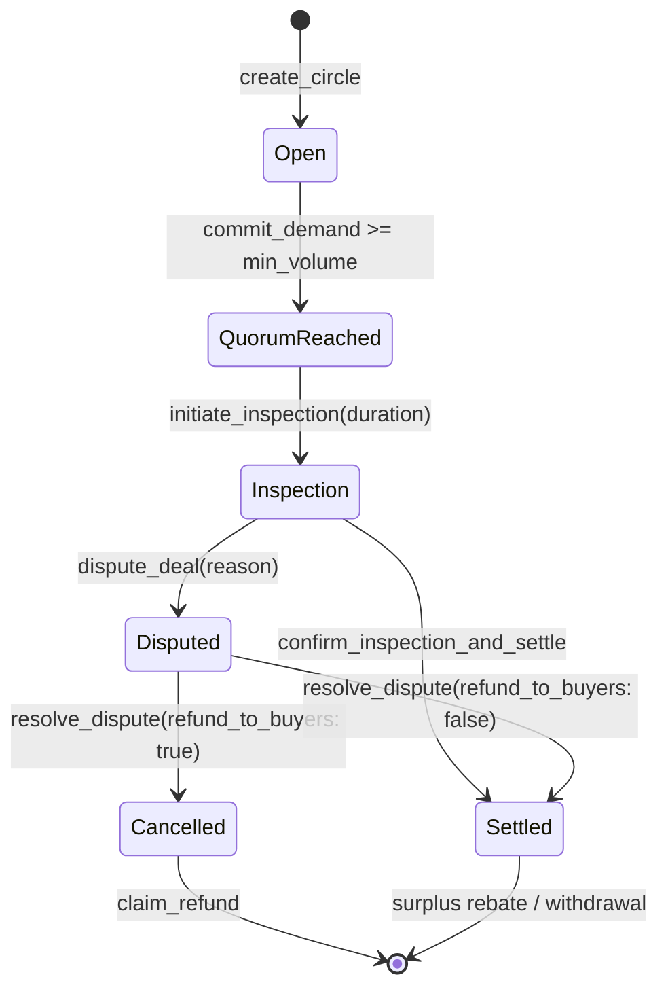
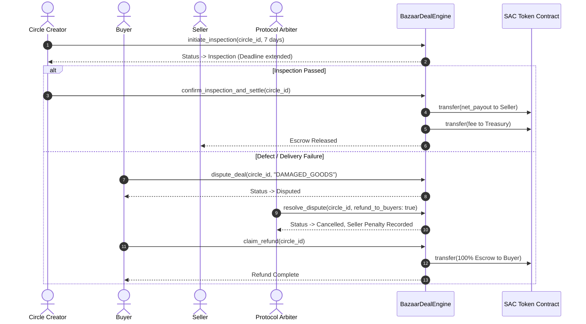

# Commercial Inspection & Dispute Resolution Architecture

In B2B bulk commerce and decentralized demand aggregation, escrow cannot immediately be released without proof of fulfillment and inspection of delivered bulk freight. Stellar Bazaar introduces an on-chain **Two-Step Inspection & Dispute Arbitration Framework** natively built on Soroban.

## 1. Lifecycle Overview

---

## 2. States & Roles

| State | Allowed Actors | Permitted Operations |
|---|---|---|
| **Inspection** | Circle Creator | `confirm_inspection_and_settle` releases escrow payout to seller. |
| **Inspection** | Creator & Committed Buyers | `dispute_deal(circle_id, reason)` opens formal arbitration. |
| **Disputed** | Protocol Admin | `resolve_dispute(circle_id, refund_to_buyers)` arbitrates. |
| **Cancelled** | Committed Buyers | `claim_refund(circle_id)` reclaims 100% of committed capital. |

---

## 3. Sequence Diagram

---

## 4. Protocol Fee Treasury

The protocol fee is governed by the contract admin and capped at a maximum of **10.00% (1,000 bps)**:

- `set_protocol_fee(caller, fee_bps)`: Configures fee basis points (`bps <= 1000`).
- `set_treasury(caller, treasury_address)`: Configures recipient treasury account.
- `get_protocol_fee_bps()`: Queries active fee bps.
- `get_treasury()`: Queries active treasury address.

During deal settlement, `bazaar_math::calculate_net_payout(gross_payout, fee_bps)` computes the split, and the tokens are atomically transferred to the treasury and seller following Checks-Effects-Interactions (CEI).
