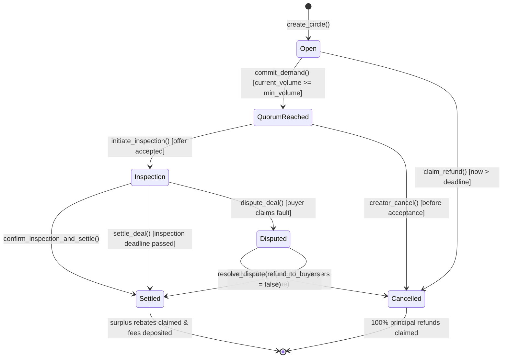

# Stellar Bazaar End-to-End Cooperative Deal Engine Specification

## 1. Cooperative Deal Engine State Machine

The **Bazaar Deal Engine** Soroban smart contract implements an immutable finite state machine governing wholesale collective buying pools:

---

## 2. Mathematical Balance Conservation Invariants

Throughout the entire lifecycle of a demand circle, the contract token escrow strictly satisfies the conservation equation:

$$\text{Contract Balance} = \sum_{i=1}^{N} \text{ActiveEscrow}(B_i) + \text{PendingSurplusPool}$$

### Upon Settlement at Wholesale Price $P_w \le P_t$:

1. **Wholesale Settlement Value**:
   $$V_w = \text{TotalUnits} \times P_w$$

2. **Protocol Fee Treasury Deduction**:
   $$F_{\text{protocol}} = \left\lfloor \frac{V_w \times \text{FeeBps}}{10,000} \right\rfloor$$

3. **Merchant Net Payout**:
   $$\text{Payout}_{\text{seller}} = V_w - F_{\text{protocol}}$$

4. **Buyer Surplus Rebate Pool**:
   $$S_{\text{pool}} = \sum_{i=1}^{N} \left[ U_i \times (P_t - P_w) \right] = (\text{TotalUnits} \times P_t) - V_w$$

5. **Individual Buyer Savings**:
   $$R(B_i) = U_i \times (P_t - P_w)$$

### Exact Conservation Proof:
$$\text{Payout}_{\text{seller}} + F_{\text{protocol}} + \sum_{i=1}^{N} R(B_i) \equiv \sum_{i=1}^{N} (U_i \times P_t) \equiv \text{Total Initial Deposit}$$

Zero stroops are locked or leaked. All math is performed via integer 128-bit stroops.

---

## 3. Storage TTL Archival Guarantees

In accordance with Soroban State Archival standards:
- **`INSTANCE_TTL_THRESHOLD`**: `17,280` ledgers (~24 hours).
- **`INSTANCE_TTL_EXTEND_TO`**: `518,400` ledgers (~30 days).
- Every state-modifying invocation (`commit_demand`, `accept_seller_offer`, `settle_deal`, `claim_surplus_rebate`) proactively extends the contract's instance storage TTL, ensuring cooperative circles never suffer state eviction mid-deal.

