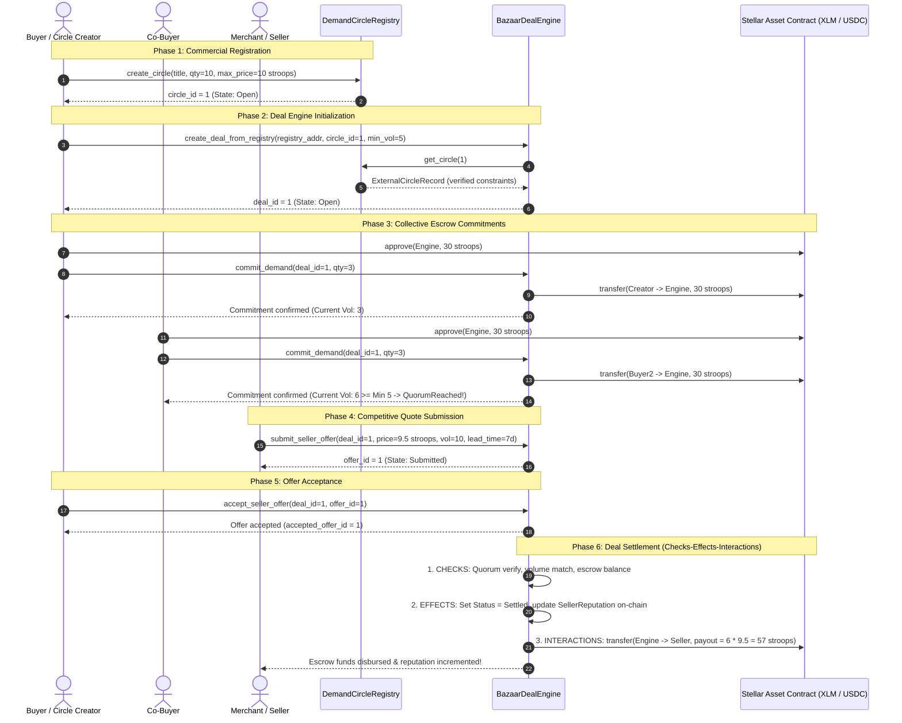
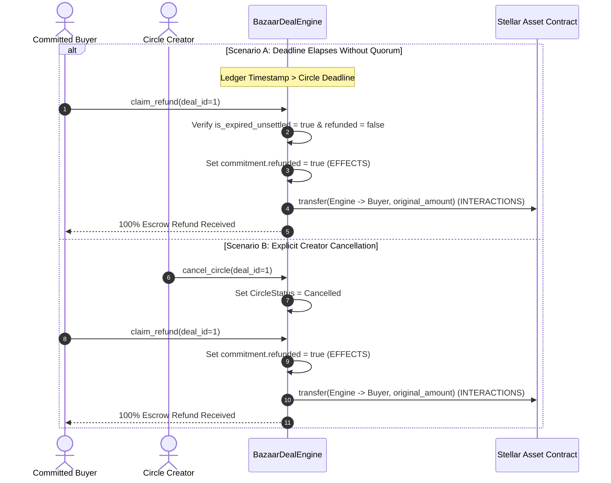

# Stellar Bazaar Protocol: Architectural Sequence Diagrams

This document details the on-chain interaction sequences between buyers, sellers, the **DemandCircleRegistry**, the **BazaarDealEngine**, and the **Stellar Asset Contract (SAC)**.

---

## 1. Complete Deal Settlement & Escrow Release Sequence

---

## 2. Unsettled / Cancelled Deal Refund Sequence

